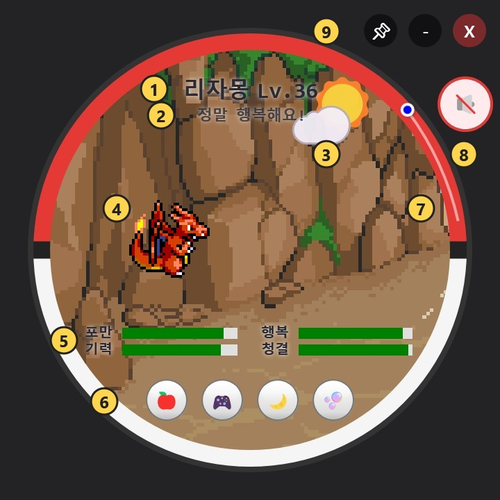

# 📘 다마포케 PC 사용 설명서

🌐 [English](./MANUAL.md) · **한국어** · [README로 돌아가기](./README.ko.md)

처음 시작하는 분을 위한 간단한 안내서입니다. 궁금한 부분만 골라 읽어도 괜찮아요.

**목차**
1. [화면 구성](#1-화면-구성)
2. [돌보기](#2-돌보기)
3. [미니게임](#3-미니게임)
4. [성장, 진화, 이별](#4-성장-진화-이별)
5. [프로필과 메달](#5-프로필과-메달)
6. [배틀과 포획](#6-배틀과-포획)
7. [체육관](#7-체육관)
8. [메가진화](#8-메가진화)
9. [파티와 가방](#9-파티와-가방)
10. [산책 모드](#10-산책-모드)
11. [설정과 업데이트](#11-설정과-업데이트)
12. [자주 묻는 질문](#12-자주-묻는-질문)

---

## 1. 화면 구성

| 번호 | 이름 | 설명 |
|:---:|---|---|
| ① | 이름과 레벨 | 지금 키우는 포켓몬 |
| ② | 기분 | 포켓몬의 상태를 한마디로 알려줘요 |
| ③ | 날씨와 시간 | 실제 시간에 따라 낮과 밤이 바뀌어요 |
| ④ | 포켓몬 | **클릭**하면 쓰다듬기, **우클릭**하면 메뉴가 열려요 |
| ⑤ | 상태 바 | 포만 · 기력 · 행복 · 청결 |
| ⑥ | 돌봄 버튼 | 🍎 밥 주기 · 🎮 놀아주기 · 🌙 재우기 · 🫧 씻기기 |
| ⑦ | 투명도 조절 | 테두리의 원호를 끌어 위젯을 투명하게 (위쪽 끝이 가장 진해요) |
| ⑧ | 소리 | 효과음 켜기/끄기 |
| ⑨ | 창 버튼 | 📌 항상 위에 고정 · − 최소화 · X 종료 |

- 몬스터볼을 마우스 왼쪽 버튼으로 끌면 원하는 곳으로 옮길 수 있어요.
- 최소화하면 작업표시줄 오른쪽 아래 **트레이 아이콘**으로 들어갑니다. 아이콘을 더블클릭하면 다시 나와요.

**우클릭 메뉴 (포켓몬 위에서)**: 📖 포켓몬 도감 · 📋 상세 프로필 · 📂 파티 · 🎒 가방 · 🍃 자연으로 놔주기

**트레이 메뉴와 단축키**

| 메뉴 | 단축키 |
|---|:---:|
| 다마포케 화면에 띄우기 | |
| 산책 모드 | `Ctrl` + `W` |
| 게임 설정 | `Ctrl` + `O` |
| 다마포케 통합 업데이트 | `Ctrl` + `U` |
| 완전히 종료하기 | |

---

## 2. 돌보기

처음에는 **알**에서 시작해요. 알은 3분이 지나거나 3번 톡톡 두드리면 부화합니다.

### 상태 4가지
| 상태 | 줄어드는 이유 | 채우는 방법 |
|---|---|---|
| 🍖 포만 | 20분마다 조금씩 | 🍎 밥 주기, 과일 받기 게임 |
| ⚡ 기력 | 20분마다 조금씩, 미니게임 | 🌙 재우기 |
| 😊 행복 | 배고프거나 더러우면 (30 미만) | 🎮 미니게임, 쓰다듬기, 좋아하는 열매 |
| 🫧 청결 | 응가 | 🫧 씻기기, 청소 게임 |

### 밥 주기 🍎
- **빨강·파랑·초록 열매**: 포만 +25
- 포켓몬마다 **좋아하는 열매**가 하나 있어요. 좋아하는 열매를 주면 포만 +35, 행복과 유대감도 올라가고, 그때부터 프로필에 표시됩니다.
- **사탕**: 포만은 조금이지만 행복이 크게 올라요. 대신 몸무게가 늘어요!

### 재우기 🌙
- 자는 동안 기력이 빠르게 차고, **기력이 100이 되면 저절로 깨어나요.**
- 밤(20:00~06:00)에는 포켓몬이 졸려 합니다.

### 씻기기 🫧
- 청결이 100이 되고 응가도 치워져요.
- 배가 부를 때 가끔 응가를 해요 (최대 3개). 응가가 있으면 청결이 떨어집니다.

### 쓰다듬기 👆
- 포켓몬을 클릭하면 행복과 유대감이 조금씩 올라요.

### ⚠️ 케어 실수와 가출
- 상태 중 하나라도 **10 이하**로 떨어지면 **케어 실수**가 1번 쌓여요. (1시간에 최대 1번)
- 케어 실수가 쌓이면 진화가 그만큼 늦어지고 유대감이 떨어집니다.
- 네 가지 상태가 **모두 0인 채로 1시간**이 지나면 포켓몬이 가출해요. 😢

---

## 3. 미니게임

🎮 버튼을 누르면 4가지 미니게임 중에서 고를 수 있어요. 미니게임은 기력과 포만을 조금 씁니다.

| 게임 | 조작 | 끝나는 조건 | 보상 |
|---|---|---|---|
| **공 튕기기** | 마우스로 포켓몬을 움직여 공을 받아요 | 3번 놓치면 | 행복, 스피드 훈련, 몸무게 감소 |
| **과일 받기** | 마우스로 포켓몬을 움직여 과일을 받아요 | 10초 | 포만, 스피드 훈련 |
| **리듬 메모리** | 빛나는 버튼 순서를 따라 눌러요 | 한 번 틀리면 | 유대감 |
| **오염 청소** | 생기는 얼룩을 클릭해서 지워요 | 얼룩이 3개 쌓이면 | 청결, 유대감 |

---

## 4. 성장, 진화, 이별

- 켜 둔 시간 **1시간에 1레벨**씩 자라요. 몸무게는 시간이 지나면 조금씩 빠집니다.
- **진화 레벨**에 도달하고 **상태가 모두 40 이상**이면 `✨ 진화하기 ✨` / `💤 다음에` 버튼이 나타나요.
  - 케어 실수 1번마다 진화 레벨이 1씩 늦어져요.
  - 레벨이 아닌 방법(돌, 교환 등)으로 진화하는 포켓몬은 Lv.36에 진화할 수 있어요.
  - 진화 갈래가 여러 개면 그중 하나로 무작위 진화합니다.
- 함께한 시간이 **이별 기준일**(설정, 기본 3일)이 지나면 `⭐ 작별하기 ⭐` 버튼이 나타나요.
  - 작별하면 새 알이 찾아와요. 잘 돌봐 준 포켓몬과 작별할수록 다음 알이 **이로치**일 확률이 올라갑니다.
- 우클릭 메뉴의 **🍃 자연으로 놔주기**로 언제든 놓아줄 수도 있어요.

> 이로치, 암수 차이, 리전폼으로 태어날 수도 있어요. 부화할 세대는 설정에서 고를 수 있습니다.

---

## 5. 프로필과 메달

우클릭 → **📋 상세 프로필 열기**. 좌우로 넘기며 6쪽을 볼 수 있어요.

1. **체육관** — 모은 배지. 배지를 클릭하면 `도전하기`
2. **정보** — 이름, 성별, 폼, 케어 연속일, 유대감, 좋아하는 열매
3. **배틀 능력치** — 공격·방어·스피드, `⚔️ 야생 배틀 시작`
4. **기술** — 지금 쓸 수 있는 기술 4개
5. **메달** — 아래 8가지
6. **성장** — 다음 레벨, 진화 조건, 케어 실수, 몸무게

| 메달 | 조건 |
|---|---|
| Lv.10 / Lv.25 / Lv.50 | 해당 레벨 달성 |
| 입맛 발견 | 좋아하는 열매 찾기 |
| 7일 돌봄 | 7일 연속으로 돌보기 |
| 유대감 MAX | 유대감 100 |
| 최종 진화 | 마지막 단계까지 진화 |
| 퍼펙트 바디 | Lv.5 이상, 몸무게 0, 케어 실수 0 |

---

## 6. 배틀과 포획

야생 배틀은 프로필의 `⚔️ 야생 배틀 시작`으로 시작하거나, 가만히 있을 때 **갑자기 나타나기도** 해요.

### 행동
| 버튼 | 설명 |
|---|---|
| **공격** | 기술 4개 중 하나를 골라요 |
| **회피** | 70% 확률로 피하지만, 실패하면 다음 공격을 2배로 맞아요 |
| **가방** | 상처약 등 아이템 사용 |
| **도망** | 배틀에서 빠져나와요 |

- **타입 상성**과 **자속 보정**(자기 타입 기술 1.5배)이 적용돼요.
- **상태이상**: 화상, 독, 맹독, 마비, 잠듦, 얼음
- **능력 변화 기술**: 위력이 없는 기술(울음소리, 칼춤 등)은 공격·방어·스피드 등을 최대 ±6단계까지 올리거나 내려요.
- **선공**: 스피드가 빠른 쪽이 먼저 움직이지만, 느린 쪽도 20% 확률로 먼저 움직일 수 있어요. 마비되면 스피드가 절반이 됩니다.

### 포획
- 이기면 `잡기` 버튼이 나와요. 상대 체력이 낮을수록 잘 잡혀요. (기본 10% → 체력 절반 이하 35% → 20% 이하 70%)
- 파티가 꽉 차 있으면 내보낼 멤버를 고를 수 있어요.

### 결과
- **이기면**: 공격 훈련, 유대감 상승, 새 기술 배우기 제안, 가끔 아이템과 메가스톤 조각
- **지면**: 행복과 기력이 떨어져요

> 💡 자리를 비운 사이 나타난 야생 포켓몬은, **1분 동안 아무 조작이 없으면 자동으로 도망**처리돼요.
> 야생 포켓몬은 내 레벨 ±2이고, 설정에서 고른 세대에서만 나와요. 아주 드물게 전설·이로치도 나타납니다.

---

## 7. 체육관

- 프로필 **1쪽(체육관)**에서 배지를 클릭하고 `도전하기`를 누르세요.
- 관동부터 팔데아까지 **관장 64명**에게 **순서대로** 도전해요.
- **첫 승리**: 배지 + 고급상처약 2개 + 몬스터볼 3개 (+ 메가링이 있으면 메가스톤 조각 3개)
- **재대결**: 이긴 관장과 언제든 다시 싸울 수 있어요. 보상은 조금 적어요.

---

## 8. 메가진화

### 준비물
1. **메가링** — 체육관 배지 **8개**를 모으면 받아요.
2. **메가스톤** — 조각 **10개**를 모으면 완성돼요.
3. 그 포켓몬의 **메가 이미지** (업데이트로 받기)

### 조각 얻는 곳
| 장소 | 확률 |
|---|---|
| 야생 배틀 승리 | 10% |
| 체육관 승리 / 재대결 | 확정 |
| 산책 중 아이템 | 찾은 아이템의 30% |

조각은 **대표 포켓몬의 스톤이 가장 잘** 나오고, 다음으로 **파티 포켓몬의 스톤**이 잘 나와요. 가방의 **💎 메가스톤** 탭에서 모은 개수를 볼 수 있어요.

### 배틀에서
- 배틀 중 **💎 메가진화** 버튼을 누르면 **턴을 쓰지 않고** 메가진화해요. 배틀마다 한 번.
- 메가 폼이 여러 개면(리자몽 X/Y 등) 고를 수 있어요.
- 배틀이 끝날 때까지 메가 폼의 능력치와 타입이 적용됩니다.

### 산책에서
- 메가진화할 수 있는 포켓몬은 산책 중에 **가끔 3분 동안 메가진화**했다가 돌아와요. (폼은 무작위)
- 산책을 시작하고 1~3분 뒤에 처음, 그다음은 10~20분마다. 여러 마리가 각자 따로 변신해요.

---

## 9. 파티와 가방

### 파티 📂
- 최대 6마리. 우클릭 → **📂 파티 보기**
- `대표로` — 이 포켓몬을 메인 화면에서 키워요.
- `교체` — 두 멤버의 순서를 바꿔요.

### 가방 🎒
- **🎒 가방** 탭: 상처약, 몬스터볼 등. 배틀 중에도 쓸 수 있어요.
- **💎 메가스톤** 탭: 메가링 여부와 스톤/조각 개수

---

## 10. 산책 모드

`Ctrl` + `W` 또는 트레이 메뉴의 **산책 모드**로 시작해요. 메인 위젯은 숨고 **파티 포켓몬들이 바탕화면을 돌아다닙니다.**

- 포켓몬을 마우스로 끌어 옮길 수 있어요.
- 가끔 **풀숲을 뒤적여** 아이템을 찾아와요 (산책마다 최대 5개). 돌아오면 무엇을 찾았는지 알려줘요.
- 산책 중에도 시간은 흐르지만 상태는 **30 아래로 떨어지지 않아요.** 자리를 비워도 안심!
- 파티 전체가 평소의 **⅓ 속도**로 함께 성장해요.
- **끝내기**: 포켓몬 위에서 `Ctrl` + `W`, 또는 트레이 아이콘 더블클릭 / **다마포케 화면에 띄우기**
- 배틀, 미니게임, 진화 중에는 산책을 시작할 수 없어요.

설정에서 **마릿수(1~6)**, **크기(0.5~5배)**, **작업표시줄 위에서만 놀기**를 바꾸면 산책 중에도 바로 적용돼요. 너무 크면 화면에 맞게 자동으로 줄여요.

---

## 11. 설정과 업데이트

### 게임 설정 (`Ctrl` + `O`)
| 항목 | 설명 |
|---|---|
| 언어 | 한국어 / English (포켓몬·기술 이름까지 바뀌어요) |
| 시스템 트레이 알림 사용 | 배고픔 등 알림 풍선 |
| 이별 기준일 | 며칠 뒤에 작별할 수 있는지 |
| 바탕화면 포켓몬 수 | 산책 마릿수 (1~6) |
| 포켓몬 크기 (배율) | 산책 크기 (0.5~5배) |
| 작업표시줄 위에서만 놀기 | 산책 범위를 작업표시줄 위로 제한 |
| 부화 대상 세대 선택 | 알과 야생 포켓몬이 나올 지방 |
| 공장 초기화 | 모든 진행을 지우고 처음부터 |

### 통합 업데이트 (`Ctrl` + `U`)
1. 포켓몬 데이터 (이름, 종족값)
2. 포켓몬 기술 (레벨업 기술)
3. 빠진 포켓몬 이미지 확인 및 받기
4. 다마포케 최신 버전 확인 및 설치

> 처음 실행할 때 이미지나 데이터가 없으면 필요한 항목이 체크된 업데이트 창을 열어 줘요.

---

## 12. 자주 묻는 질문

**Q. 포켓몬이 안 보이거나 빈 화면이에요.**
A. 이미지를 아직 받지 않은 거예요. `Ctrl` + `U` → **빠진 포켓몬 이미지 확인 및 받기**를 실행하세요.

**Q. 세이브는 어디에 있나요?**
A. 프로그램 폴더의 `save.json`입니다. 직전 세이브는 `save.bak.json`으로 백업되고, 파일이 손상되면 백업에서 자동으로 복구해요. 복구할 수 없을 때는 손상된 파일을 `save.corrupt-날짜.json`으로 남겨 둡니다. 설정은 `settings.json`에 있어요.

**Q. 새 버전으로 옮기려면?**
A. 새 zip을 풀고 예전 폴더의 `save.json`, `settings.json`을 복사해 넣으면 돼요. 또는 업데이트 창의 4번으로 자동 설치할 수 있어요.

**Q. 컴퓨터를 끄면 시간이 멈추나요?**
A. 네. 다마포케는 **켜져 있는 동안만** 시간이 흘러요. 레벨, 이별 기준일, 상태 감소 모두 실행 시간 기준이에요. 켜 둔 채로 자리를 오래 비울 때는 **산책 모드**로 두면 상태가 30 아래로 떨어지지 않아요.

**Q. 메가진화 버튼이 안 보여요.**
A. 메가링(배지 8개), 그 포켓몬의 메가스톤, 메가 이미지가 모두 있어야 해요. 배틀마다 한 번만 쓸 수 있어요.

**Q. 진화를 안 해요.**
A. 프로필 **성장** 쪽에서 진화 조건을 확인하세요. 상태가 모두 40 이상이어야 하고, 케어 실수만큼 진화 레벨이 늦어져요.
