

# 🐾 TamaPoke PC (다마포케)

**윈도우 바탕화면에서 함께 사는 레트로 포켓몬 다마고치**

알을 부화시키고, 돌봐주고, 산책을 시키고, 체육관에 도전하고, 메가진화까지 — 작은 몬스터볼 위젯 하나로 즐겨보세요.

🌐 [English](./README.md) · **한국어**

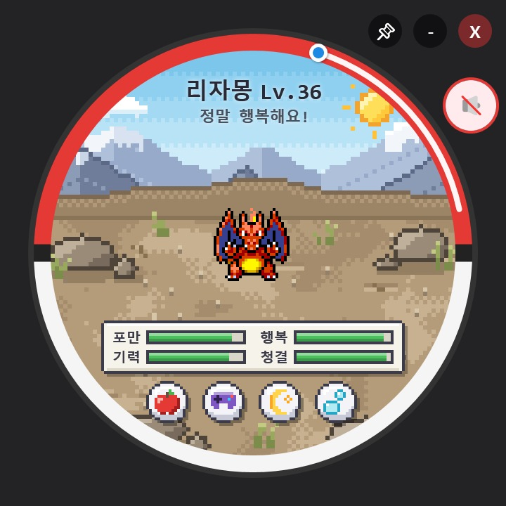&nbsp;&nbsp;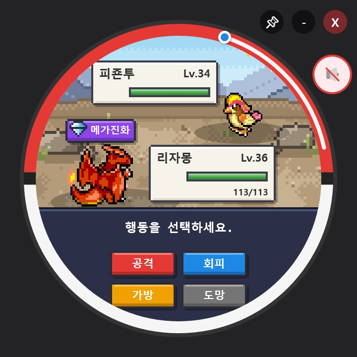

---

## ✨ 주요 특징

| | | |
|:---:|:---:|:---:|
| 🥚 **육성과 진화** 부화, 밥 주기, 놀아주기, 재우기, 씻기. 실제 시간에 따라 성장하고 진화합니다. | 🚶 **바탕화면 산책** 파티가 작업표시줄 위를 돌아다니며 풀숲을 뒤져 아이템을 찾아옵니다. | ⚔️ **배틀과 체육관** 야생 배틀, 상태이상, 포획, 그리고 9개 지방의 체육관 관장 64명. |
| 💎 **메가진화** 메가링을 얻고 메가스톤 조각을 모아 배틀마다 한 번 메가진화! | 📖 **포켓몬 도감** 1,025마리 전체를 지방별로 정리. 부화와 포획으로 채워 나가요. | 🌐 **한국어 / 영어** 포켓몬·기술 이름까지 설정에서 바로 바뀝니다. |

---

## 📸 스크린샷

| 메인 화면 | 밤에 잠자기 | 밥 먹기 |
|:---:|:---:|:---:|
|  | 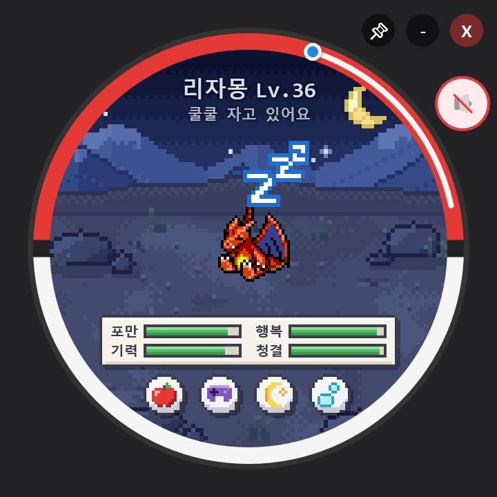 | 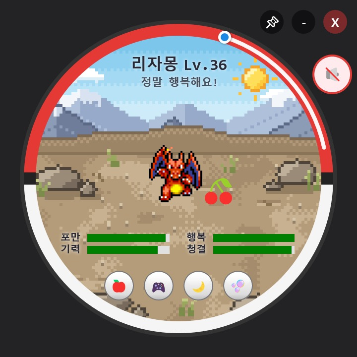 |
| **야생 배틀** | **메가진화** | **체육관 배지** |
|  | 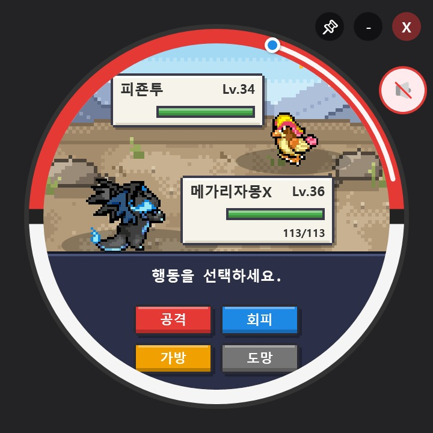 | 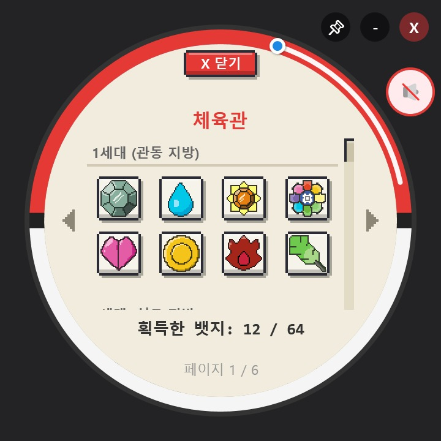 |
| **포켓몬 도감** | **파티** | **가방과 메가스톤** |
| 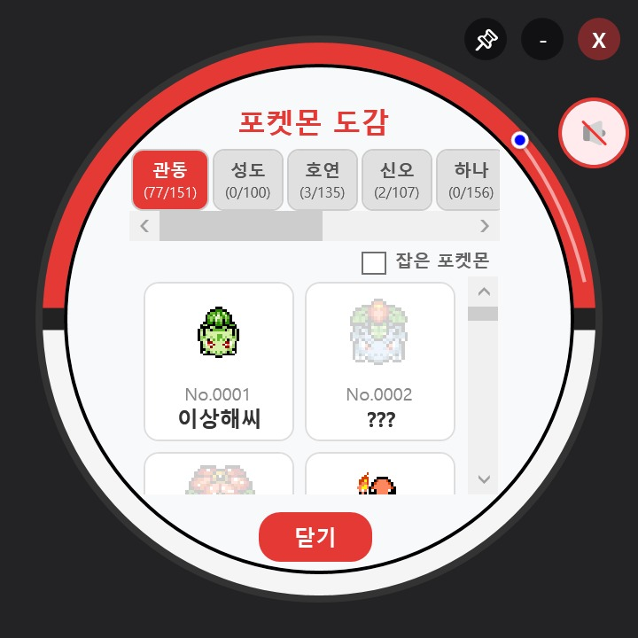 | 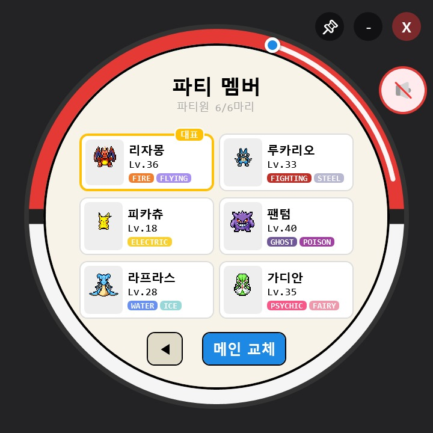 | 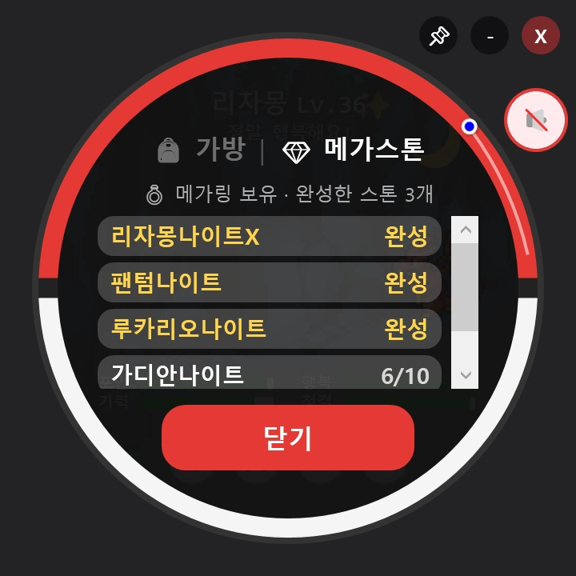 |

**산책 모드 — 파티 포켓몬들이 작업표시줄 위를 돌아다녀요**

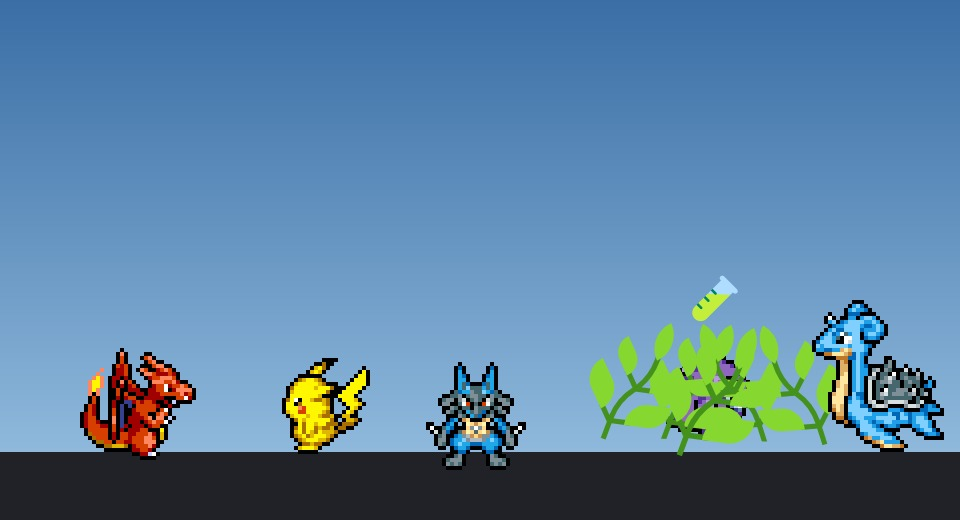

| 게임 설정 | 통합 업데이트 |
|:---:|:---:|
| 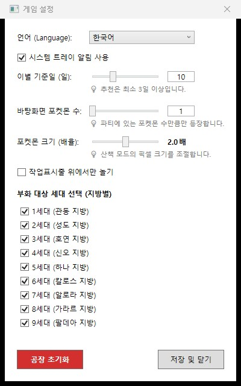 | 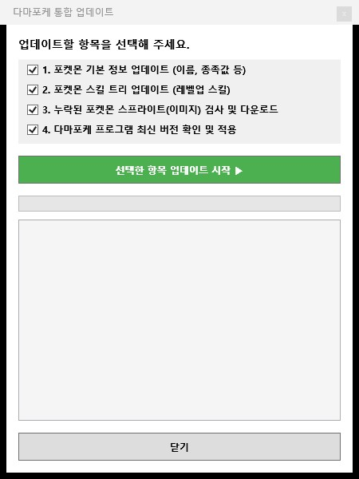 |

---

## 🚀 시작하기

1. [.NET 9 데스크톱 런타임](https://dotnet.microsoft.com/download/dotnet/9.0)을 설치합니다. (Windows 10 / 11)
2. [Releases](https://github.com/gomdolit-jeong/TamaPoke_PC/releases/latest)에서 최신 `TamaPoke_vX.X.X.X.zip`을 받아 원하는 곳에 압축을 풉니다.
3. `TamaPoke.exe`를 실행합니다.
4. 처음 실행하면 포켓몬 이미지를 받을지 물어봅니다. **예**를 누르면 업데이트 창이 알아서 받아옵니다. (몇 분 정도 걸려요)

> 진행 상황은 프로그램 폴더의 `save.json`에 자동 저장되고, 직전 세이브는 `save.bak.json`으로 백업됩니다.

---

## 🎮 플레이 방법

몬스터볼 위젯을 마우스 왼쪽 버튼으로 끌어서 바탕화면 어디에든 둘 수 있습니다.

### 돌봄 버튼
| 버튼 | 동작 |
|:---:|---|
| 🍎 | **밥 주기** — 열매를 골라 *포만감*을 채워요 |
| 🎮 | **놀아주기** — 미니게임으로 *행복도*를 올려요 |
| 🌙 | **재우기** — 푹 재워서 *기력*을 회복해요 |
| 🫧 | **씻기기** — 목욕으로 *청결도*를 유지해요 |

### 우클릭 메뉴 (포켓몬 위에서)
📖 포켓몬 도감 · 📋 상세 프로필 (능력치, 체육관, 메달, 야생 배틀) · 📂 파티 · 🎒 가방 · 🍃 자연으로 놔주기

### 트레이 메뉴와 단축키
| 메뉴 | 단축키 | 설명 |
|---|:---:|---|
| 다마포케 화면에 띄우기 | | 숨겨진 위젯을 다시 앞으로 불러와요 |
| 산책 모드 | `Ctrl` + `W` | 파티 포켓몬들이 바탕화면을 돌아다녀요 |
| 게임 설정 | `Ctrl` + `O` | 언어, 알림, 이별 기준일, 산책 옵션, 부화 세대 선택 |
| 다마포케 통합 업데이트 | `Ctrl` + `U` | 데이터·이미지 받기와 새 버전 확인 |
| 완전히 종료하기 | | 모든 진행 상황을 저장하고 종료해요 |

단축키는 메인 화면이 선택되어 있을 때 동작합니다.

---

## 🌟 기능 자세히 보기

<b>🥚 생애 주기와 진화</b>

- 포만감·행복·기력·청결 4가지 상태를 관리합니다. 오래 돌보지 않으면 케어 실수가 쌓이고, 너무 오래 방치하면 가출할 수도 있어요.
- 실제 시간 1시간에 1레벨씩 성장하고, 진화 레벨이 되면 진화합니다. (진화 보류 가능)
- 이로치, 암수 차이, 리전폼으로 태어날 수도 있어요.
- 이별 기준일이 되면 작별하고, 새로운 알과 함께 다시 시작합니다.

<b>🚶 산책 모드</b>

- 파티 포켓몬들이 바탕화면(또는 작업표시줄 위)을 돌아다닙니다. 크기는 설정에서 조절할 수 있어요.
- 산책 중에도 시간은 흐르지만, 상태가 일정 아래로는 떨어지지 않아 자리를 비워도 가출하지 않습니다. 파티 전체가 평소의 ⅓ 속도로 함께 성장해요.
- 가끔 풀숲에 뛰어들어 상처약, 몬스터볼, 메가스톤 조각 같은 아이템을 찾아옵니다.

<b>⚔️ 배틀, 포획, 체육관</b>

- 타입 상성, 자속 보정, 회피, 상태이상(화상·독·맹독·마비·잠듦·얼음)이 있는 턴제 배틀.
- 야생 포켓몬의 체력을 깎고 몬스터볼을 던져 포획하세요. 파티가 꽉 차 있으면 내보낼 멤버를 고를 수 있어요.
- 관동부터 팔데아까지 체육관 관장 64명에게 차례로 도전하고, 이긴 관장과는 재대결도 할 수 있습니다.
- 배틀에서 이기면 새 기술을 배울 수 있어요.

<b>💎 메가진화</b>

- 체육관 배지 8개를 모으면 **메가링**을 받습니다.
- 메가스톤 **조각 10개**를 모으면 스톤이 완성돼요. 조각은 야생 배틀, 체육관 승리, 산책에서 얻을 수 있고 대표·파티 포켓몬의 스톤이 잘 나옵니다.
- 배틀 중 **💎 메가진화** 버튼으로 배틀마다 한 번, 턴을 쓰지 않고 메가진화! 배틀이 끝날 때까지 메가 폼의 능력치와 타입이 적용됩니다.
- 이미지가 있는 모든 메가 폼을 지원합니다. *Legends Z-A*의 새로운 메가진화와 원시회귀도 포함돼요.

<b>🛡️ 안전한 저장과 데이터 관리</b>

- 세이브는 안전하게 저장되고 백업되며, 파일이 손상되면 백업에서 자동으로 복구합니다.
- 시작할 때 데이터 파일이나 포켓몬 이미지가 없거나 손상되었는지 확인하고, 필요한 항목만 체크된 업데이트 창을 열어 줍니다.

---

## 🛠️ 기술 스택

- **Language**: C#
- **Framework**: WPF (.NET 9)
- **Architecture**: MVVM 패턴
- **Data**: JSON ([PokéAPI](https://pokeapi.co/) 기반 게임 데이터, 세이브 파일, 번역 파일)

---

## 🔗 참고 오픈소스 및 원작 리포지토리 (References)

본 데스크톱 프로젝트는 아래의 임베디드/웹 기반 원작 `TamaPoke` 프로젝트들의 게임 루프, 기획 및 아이디어를 참고하여 데스크톱 환경에 맞게 재구성되었습니다:

* [socquique/TamaPoke](https://github.com/socquique/TamaPoke) — 원작 펌웨어 및 기본 다마고치 메커니즘
* [ShadowEnemyx/TamaPoke (Expanded Update)](https://github.com/ShadowEnemyx/TamaPoke/tree/tamapoke-expanded-update) — 확장 기능 및 콘텐츠 레퍼런스
* [DylanPDao/TamaPoke](https://github.com/DylanPDao/TamaPoke) — 배틀 및 추가 시스템 확장 아이디어

---

## 📝 Credits & Acknowledgements

* **Sprite Assets**: 게임 내 사용된 모든 포켓몬 도트 스프라이트(Sprites)는 포켓몬 불가사의 던전 커뮤니티의 오픈소스 프로젝트인 [PMDCollab/SpriteCollab](https://github.com/PMDCollab/SpriteCollab)의 원본 리소스를 활용하였습니다. 고품질의 스프라이트를 제공해 주신 커뮤니티 기여자분들께 깊은 감사를 드립니다.
  * 해당 리소스는 **Creative Commons Attribution-NonCommercial 4.0 International (CC BY-NC 4.0)** 라이선스에 따라 비상업적 목적으로만 사용되었습니다.
  * 라이선스 전문 확인: [https://creativecommons.org/licenses/by-nc/4.0/](https://creativecommons.org/licenses/by-nc/4.0/)
* **Badge Images**: 본 프로젝트에 사용된 체육관 뱃지 이미지는 [Bulbapedia](https://bulbapedia.bulbagarden.net/wiki/Main_Page)의 자료를 참고 및 인용하였습니다.
* **Disclaimer**: 이 프로젝트는 비상업적 팬 프로젝트(Fan Project)이며, 포켓몬스터(Pokémon)와 관련된 모든 저작권 및 상표권은 Nintendo, Creatures Inc., GAME FREAK inc. 에 귀속되어 있습니다.
